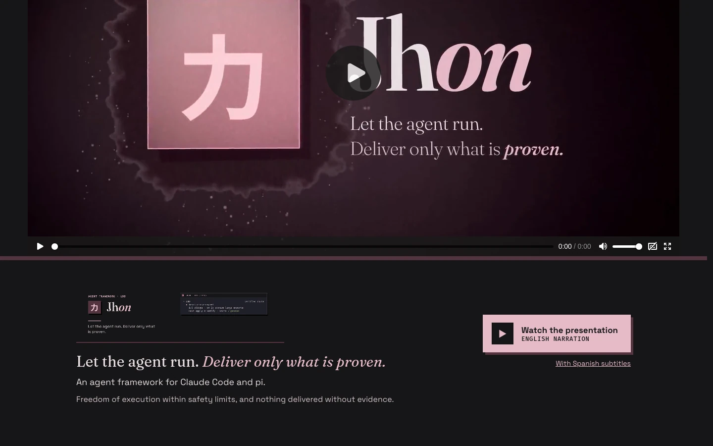
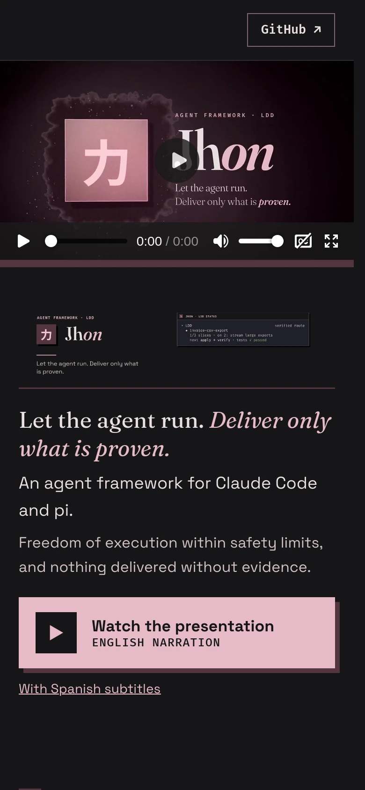
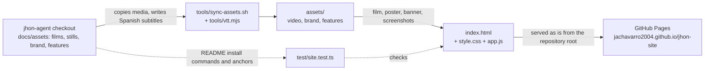

<p align="center">
  
</p>

<p align="center">
  <b>Let the agent run. Deliver only what is proven.</b><br>
  An agent framework for Claude Code and pi.
</p>

<p align="center">
  <a href="LICENSE"></a>
  <a href="https://github.com/jachavarro2004/jhon-agent/actions/workflows/validate.yml"></a>
  <a href="https://github.com/sponsors/jachavarro2004"></a>
  <a href="https://github.com/jachavarro2004/jhon-site/stargazers"></a>
</p>

## See it

<p align="center">
  
  
</p>

The presentation film the page opens with (3:39):

https://github.com/user-attachments/assets/e5d924c2-0a05-4a5f-82a9-1ab303276258

<details>
<summary>With Spanish subtitles</summary>

https://github.com/user-attachments/assets/0ae10efb-b546-4f5c-be7d-87e6415f27fa

</details>

Live at [jachavarro2004.github.io/jhon-site](https://jachavarro2004.github.io/jhon-site/).

## What it is

The landing page for [jhon-agent](https://github.com/jachavarro2004/jhon-agent),
Jhon's agent framework for Claude Code and pi: the presentation film first, then
why Jhon, how it works, how to install it, the docs and the support block.

- Plain HTML, CSS and a little JavaScript; no framework, no external requests.
  GitHub Pages serves it as is from the repository root.
- `assets/` holds copies of Jhon's films (the presentation and the teaser, each
  in English and with Spanish subtitles; Jhon's README links them here), the
  film's poster, the brand banner and the feature screenshots.
- The page's text is in English.

## Use

Preview the page locally from the repository root:

```sh
python3 -m http.server --bind 127.0.0.1 8000
# then open http://127.0.0.1:8000/
```

Check it (`JHON_AGENT` names a jhon-agent checkout; default `../jhon-agent`):

```sh
node --experimental-strip-types --test test/site.test.ts
```

The checks cover the page's links, alt text and lazy film, that its install
commands and README anchors match jhon-agent's README, Jhon's identity (the
banner, byte-identical to jhon-agent's, the tagline, the support block and the
fonts) and this README's skeleton and media.

Refresh the films, poster, banner and screenshots from a jhon-agent checkout,
and write the film's Spanish subtitles:

```sh
tools/sync-assets.sh [path to a jhon-agent checkout]
```

## How it works



The page loads only its own files: the film waits for its play control, and
JavaScript only turns the install panels into tabs and copies commands; without
it the page still works.

## Docs

- [The live page](https://jachavarro2004.github.io/jhon-site/)
- [jhon-agent's README](https://github.com/jachavarro2004/jhon-agent#readme): what Jhon is, install and use
- [Jhon's identity kit](https://github.com/jachavarro2004/jhon-agent/blob/main/docs/identity.md): the mark, words, look, badges and support block every Jhon repo shares
- [Support](SUPPORT.md) · [Security](SECURITY.md) · [Code of conduct](CODE_OF_CONDUCT.md)

## Support jhon-agent

jhon-agent is free and open source.
If it helps you, donate any amount you choose,
once or monthly, on GitHub Sponsors.
If you can't donate, a ⭐ on the [repo](https://github.com/jachavarro2004/jhon-agent) helps
keep the project maintained.

[♥ Sponsor on GitHub](https://github.com/sponsors/jachavarro2004)

## License

Apache-2.0, like Jhon: [`LICENSE`](LICENSE).
